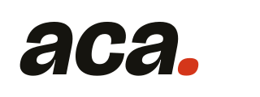
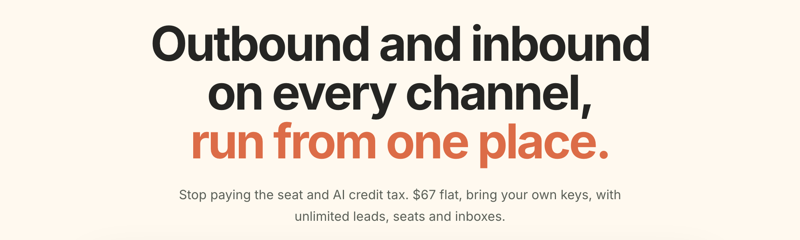
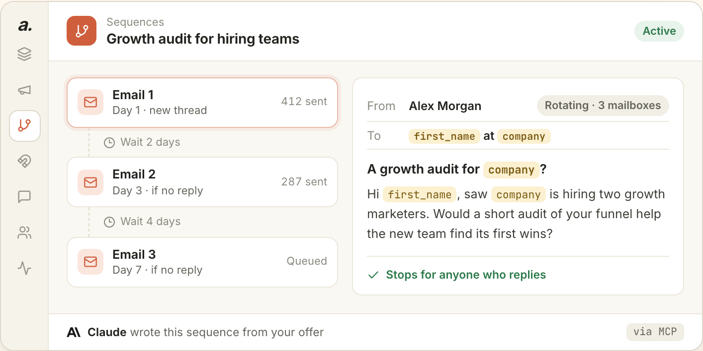
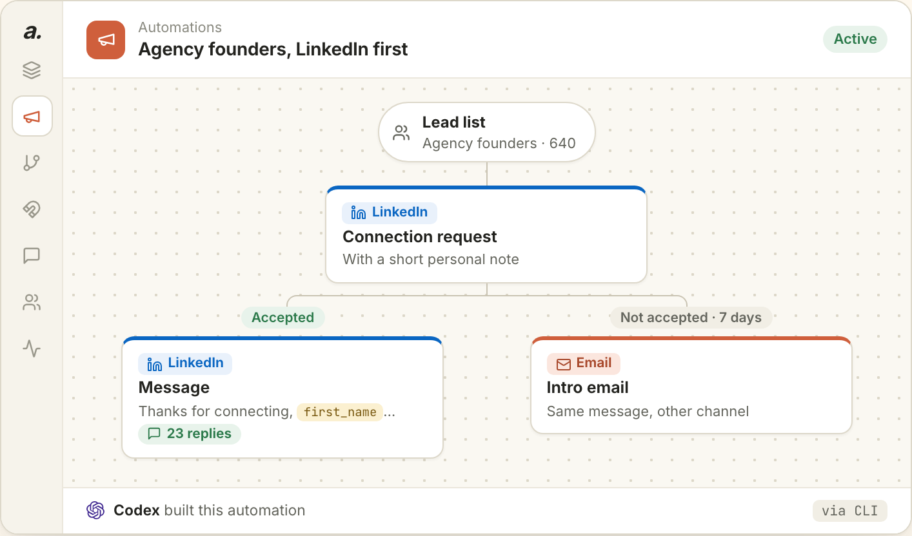
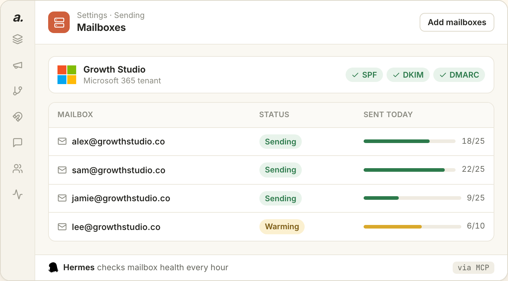
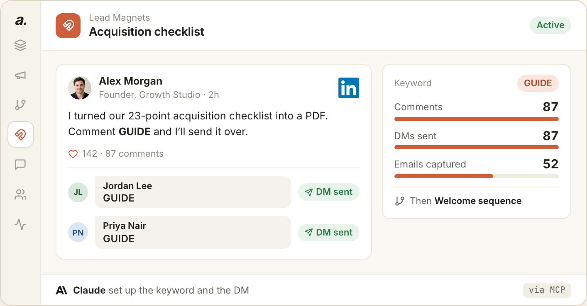
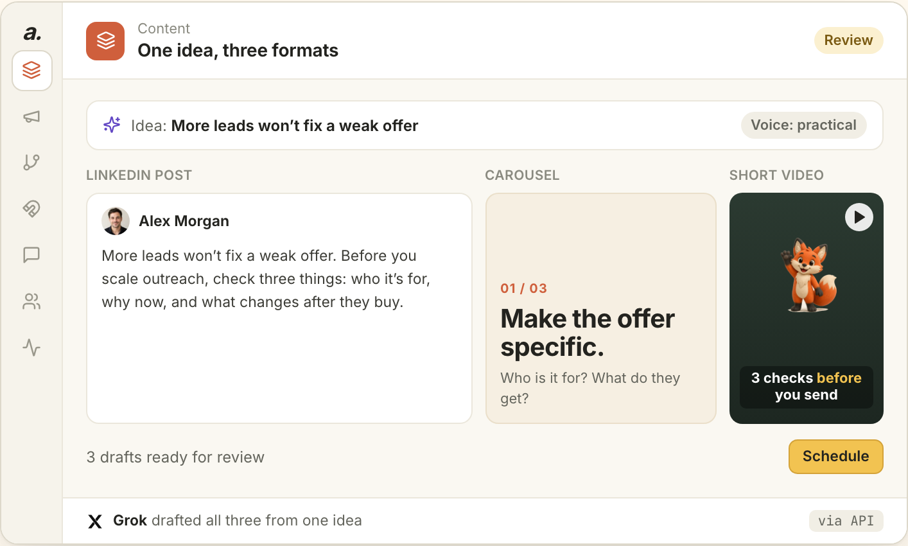

<p align="center">
  <a href="https://www.automatedclientacquisition.com">
    <picture>
      <source media="(prefers-color-scheme: dark)" srcset=".github/assets/logo-dark.svg">
      
    </picture>
  </a>
</p>

<p align="center">
  
</p>

<p align="center">
  Cold email, LinkedIn, buying signals, one inbox and AI content in a single workspace.<br>
  It replaces Instantly, HeyReach and Gojiberry. Run it yourself for free, or let us host it for $67 a month.
</p>

<p align="center">
  <a href="https://www.automatedclientacquisition.com/get-started"><b>Try the hosted version</b></a> ·
  <a href="#install">Install</a> ·
  <a href="https://www.automatedclientacquisition.com">Website</a> ·
  <a href="https://www.automatedclientacquisition.com/developers">API</a> ·
  <a href="https://github.com/seguelaCedric/aca-cli">CLI</a> ·
  <a href="https://github.com/seguelaCedric/n8n-nodes-aca">n8n node</a>
</p>

<p align="center">
  <a href="LICENSE.md"></a>
  <a href="https://www.automatedclientacquisition.com/pricing"></a>
</p>

> [!NOTE]
> The code is being prepared for release here. Before it lands we are rotating keys, building a
> clean database baseline you can create from scratch, and writing a Docker Compose setup.
> **Star or watch the repo** to hear when it ships. The [hosted version](https://www.automatedclientacquisition.com/get-started) is live today.

## Three subscriptions, one workspace

Most outbound teams pay for a cold email tool, a LinkedIn tool and a lead-finding tool, then
copy leads between them. ACA does all three jobs on the same contact record, so the buying signal
that found a lead, the LinkedIn connection request, the email follow-up and the reply all sit in
one place.

| You pay for | To do | Their price | In ACA |
|---|---|---|---|
| **Instantly** | Cold email: sequences, mailbox rotation, warmup, a shared inbox | $47/mo for 5,000 emails, $97/mo for 125,000 | Email sequences with mailbox rotation, a warmup network that checks inbox placement, and one inbox for every reply |
| **HeyReach** | LinkedIn outreach from several accounts | $79 per LinkedIn sender per month | LinkedIn campaigns (connection requests, messages, InMail) across your connected accounts, with email steps in the same sequence |
| **Gojiberry** | Finding warm leads from buying signals | $99 per user per month, plus $59 per extra AI agent | Buying signals (hiring, funding, acquisitions, leadership changes, growth) and the people engaging with your posts or a competitor's, scored against your ICP |

A team of three, each with their own LinkedIn account, sending 20,000 cold emails a month, pays
**$631 a month** for those three tools: Instantly $97, HeyReach 3 × $79 and Gojiberry 3 × $99.
Add a fourth person and the bill grows again. ACA is **$67 a month hosted** or **$0 on your own
servers**, with unlimited seats and no per-sender platform fee.

<sub>Prices from each vendor's pricing page on 2 November 2026, monthly billing; Gojiberry's
per-user price is from its [pricing guide](https://help.gojiberry.ai/en/articles/12960396-gojiberry-pricing-explained).
With any of these tools, including ACA, you still pay for your mailboxes and domains, your AI
model usage, and the provider that connects LinkedIn, WhatsApp and Telegram accounts (Unipile).
ACA adds no markup on any of them.</sub>

## What's inside

<table>
  <tr>
    <td width="50%" valign="top">
      <h3>Cold email sequences</h3>
      <p>Write emails from your offer with AI, set the delays, and let the sequence follow up. It
      stops when someone replies, pauses on out-of-office, and rotates sends across healthy
      mailboxes within each one's daily limit.</p>
      
    </td>
    <td width="50%" valign="top">
      <h3>LinkedIn campaigns</h3>
      <p>Connection requests, messages and InMail, with branches for accepted invitations and
      replies. Switch a lead to email when LinkedIn goes quiet, and spread the work across
      several connected accounts.</p>
      
    </td>
  </tr>
  <tr>
    <td width="50%" valign="top">
      <h3>Mailboxes and warmup</h3>
      <p>Set up Microsoft 365 mailboxes with SPF, DKIM and DMARC, or connect any SMTP and IMAP
      inbox. The warmup network sends between real mailboxes, checks whether each message landed
      in the inbox or spam, and moves it out of spam when it didn't.</p>
      
    </td>
    <td width="50%" valign="top">
      <h3>Lead magnets from comments</h3>
      <p>Post on LinkedIn and ask people to comment a keyword. ACA reads the comments, sends the
      lead magnet by DM, captures the email address and starts a follow-up sequence.</p>
      
    </td>
  </tr>
  <tr>
    <td width="50%" valign="top">
      <h3>Content in your voice</h3>
      <p>Turn one idea into a LinkedIn post, a carousel and a short video, review the drafts, and
      schedule them. Autopilots keep posting on a plan you set.</p>
      
    </td>
    <td width="50%" valign="top">
      <h3>Also in the box</h3>
      <ul>
        <li>One inbox for LinkedIn, email, WhatsApp, Telegram and SMS, with AI reply drafts</li>
        <li>Lead sourcing: a shared lead pool, LinkedIn and Sales Navigator search import, CSV</li>
        <li>Enrichment and email verification before anything is sent</li>
        <li>A suppression list, unsubscribe and bounce handling, and sends that stop on reply</li>
        <li>CRM with contacts, deals and a pipeline report</li>
        <li>REST API, CLI, MCP server and n8n node, so Claude, Codex or your own agents can run campaigns</li>
      </ul>
    </td>
  </tr>
</table>

<p align="center"><sub>Screens from an example workspace with sample data.</sub></p>

## Self-hosted or hosted

Same product, same code. Pick who runs the servers.

| | Self-hosted | Hosted |
|---|---|---|
| **Price** | $0 | $67/month or $490/year |
| **Seats, leads, campaigns** | Unlimited | Unlimited |
| **Database, servers, workers** | Yours (Supabase plus Docker or Fly) | Ours |
| **Updates** | Pull from this repo | Automatic |
| **AI and channel providers** | Your own keys | Your own keys, no markup |
| **Warmup network** | Through the ACA Network API | In the app |
| **Microsoft 365 tenants** | Through the ACA Network API (coming next) | In the app, $9.70 per tenant per month |
| **Support** | Community | From the ACA team |
| **Best for** | Developers and high-volume senders | Founders, teams and agencies who want it running today |

**[Start on the hosted version](https://www.automatedclientacquisition.com/get-started)**: build a
free preview from your website first, no account needed.

## Install

### Hosted, in a few minutes

1. Open [automatedclientacquisition.com/get-started](https://www.automatedclientacquisition.com/get-started)
   and enter your website. ACA drafts your buyer profile, a first email and content before you
   create an account.
2. Create your workspace.
3. Connect your senders: LinkedIn under **Settings → LinkedIn & social**, email under
   **Settings → Mailboxes** (Microsoft 365, Google, or any SMTP and IMAP inbox).

### Connect your AI agent (MCP)

ACA has a remote MCP server, so Claude, Codex, Cursor and other agents can find leads, build
campaigns and answer replies in your workspace. You sign in with OAuth; there is no API key to
paste.

**Claude (claude.ai or Claude Desktop):** Settings → Connectors → Add custom connector. Name it
ACA, use this URL, then click Connect and sign in.

```text
https://mcp.automatedclientacquisition.com/mcp
```

**Claude Code:**

```bash
claude plugin marketplace add seguelaCedric/automated-client-acquisition-plugins
claude plugin install automated-client-acquisition@automated-client-acquisition
```

**Cursor:** Settings → MCP → Add new MCP server:

```json
{
  "mcpServers": {
    "aca": {
      "type": "http",
      "url": "https://mcp.automatedclientacquisition.com/mcp"
    }
  }
}
```

Setup for Codex, OpenClaw and other clients is on the [MCP page](https://www.automatedclientacquisition.com/mcp).

### CLI

Create a token under [Settings → CLI Tokens](https://www.automatedclientacquisition.com/settings/tokens), then:

```bash
npm install -g @seguelac/aca-cli
aca login --token aca_your_token
aca campaign ls
```

Every command takes `--json` for scripts and agents. See [aca-cli](https://github.com/seguelaCedric/aca-cli).

### n8n

On n8n Cloud: Settings → Community nodes → Install, then enter `n8n-nodes-aca`. On your own n8n,
run `npm install n8n-nodes-aca` and restart it. Add an **ACA API** credential with a token from
Settings → CLI Tokens.

### REST API

The same token works on every `/v1` endpoint ([reference](https://www.automatedclientacquisition.com/developers)):

```bash
curl https://api.automatedclientacquisition.com/v1/lists \
  -H "Authorization: Bearer $ACA_TOKEN"
```

### Self-hosting

The install guide ships with the code. Watch this repo to get it. What you'll need:

- Node.js (we build on 22)
- A Supabase project, on Supabase Cloud or self-hosted with Docker, and the Supabase CLI
- Docker or a Fly.io account for the background workers (sending, inbox sync, warmup)
- Your own provider keys: an AI provider such as OpenRouter, and a Unipile account for LinkedIn,
  WhatsApp and Telegram
- A domain for the app

Setup will be: clone, create the database from one baseline migration, then start the app and
workers with Docker Compose.

### ACA Network

Some things can't be self-hosted because they rely on shared infrastructure: the warmup network
(the more mailboxes join, the better it works for everyone), the shared lead pool, and Microsoft
365 tenants. A self-hosted install uses them through the
[ACA Network API](https://www.automatedclientacquisition.com/developers) with an approved account:
bring your own mailboxes into warmup today, with tenant and mailbox ordering next.

## License

ACA is released under the [Functional Source License, Version 1.1, ALv2 Future
License](LICENSE.md) (FSL-1.1-ALv2).

- You can self-host it, change it, and use it to run your own business and your clients'
  campaigns, agencies included.
- You can't sell it, or a modified copy, as a product or hosted service that competes with ACA.
- Every version becomes Apache 2.0 two years after we release it.

We chose FSL so the code can stay public without someone repackaging it as their own SaaS.

## Trademarks

The license does not cover the "ACA" and "Automated Client Acquisition" names or logo. A fork must
use its own name and branding.

## Related

- [aca-cli](https://github.com/seguelaCedric/aca-cli): manage leads, lists, campaigns and the inbox from the terminal
- [n8n-nodes-aca](https://github.com/seguelaCedric/n8n-nodes-aca): ACA actions and triggers in n8n
- [API reference](https://www.automatedclientacquisition.com/developers): every `/v1` endpoint
